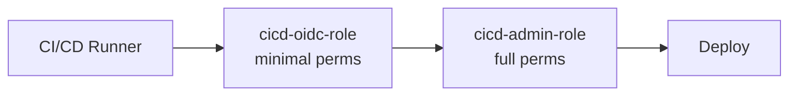

# IaC CI/CD Reference

Architecture patterns for IaC (Terraform, Ansible, CloudFormation) pipelines on AWS.

## AWS Account Model

```
┌─────────────────────────────────┐    ┌─────────────────────────────────┐
│         NON-PROD ACCOUNT        │    │          PROD ACCOUNT           │
│                                 │    │                                 │
│       10-dev    20-qat          │    │    40-stg   70-prod   90-dr     │
│                                 │    │                                 │
│          ca-central-1           │    │  ca-central-1 / ca-west-1 (DR)  │
└─────────────────────────────────┘    └─────────────────────────────────┘
```

## Core Patterns

### 1. Role Chaining



**Why:** OIDC handles auth, admin role handles permissions. See
[docs/authentication.md](docs/authentication.md)

### 2. Pipeline Triggers

| Event               | Runs?  | Why               |
| ------------------- | ------ | ----------------- |
| Feature branch push | **NO** | No value until PR |
| PR/MR opened        | YES    | Ready for review  |
| Main branch         | YES    | Merged code       |
| Manual              | YES    | Explicit action   |

See [docs/pipeline-rules.md](docs/pipeline-rules.md)

### 3. Environment Progression

```
NON-PROD ACCOUNT          PROD ACCOUNT
────────────────          ────────────
10-dev → 20-qat    →    40-stg → 70-prod → 90-dr
                                    ↑
                              requires CR
```

See [docs/conventions.md](docs/conventions.md)

---

## Generate Pipelines

Use AI with your org context + these docs:

```
Generate a [GitHub/GitLab/Jenkins] pipeline for Terraform:
- Follow docs/pipeline-rules.md for triggers
- Follow docs/authentication.md for role chaining
- 2 AWS accounts: non-prod, prod
- 5 environments: dev, qat (non-prod) | stg, prod, dr (prod account)
- Regions: ca-central-1, ca-west-1 (DR)
```

| Platform       | Guide                                                      |
| -------------- | ---------------------------------------------------------- |
| GitHub Actions | [.github/workflows/README.md](.github/workflows/README.md) |
| GitLab CI      | [gitlab-ci/README.md](gitlab-ci/README.md)                 |
| Jenkins        | [jenkins/README.md](jenkins/README.md)                     |

---

## Docs

- [Pipeline Rules](docs/pipeline-rules.md) - triggers, deployment patterns
- [Authentication](docs/authentication.md) - role chaining
- [Conventions](docs/conventions.md) - naming standards
