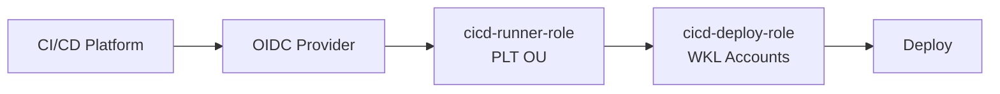

# IaC CI/CD Reference

Architecture patterns for IaC (Terraform, Ansible, CloudFormation) pipelines on AWS.

## OU Hierarchy

```
Root
├── PLT OU (Platform)
│   └── PLT-Runner Account
│
└── WKL OU (Workloads)
    ├── WKL-NPD OU (NonProd)
    │   ├── SBX Account
    │   ├── DEV Account
    │   └── QAT Account
    │
    └── WKL-PRD OU (Prod)
        ├── STG Account
        ├── PRD Account
        └── DR Account
```

**OU Code Reference:**

| Code        | Full Name         | Purpose                          |
| ----------- | ----------------- | -------------------------------- |
| **PLT**     | Platform          | CI/CD runners and shared tooling |
| **WKL**     | Workloads         | Application environments         |
| **WKL-NPD** | Workloads-NonProd | Development and testing          |
| **WKL-PRD** | Workloads-Prod    | Production and DR                |

## Core Patterns

### 1. Cross-Account Role Chaining



**Why:** Runner in PLT assumes deploy roles in WKL accounts. See
[docs/authentication.md](docs/authentication.md)

### 2. Two-StackSet Deployment

| StackSet            | Target OU | Creates                        |
| ------------------- | --------- | ------------------------------ |
| PLT Runner StackSet | PLT OU    | `cicd-runner-role` + OIDC      |
| WKL Deploy StackSet | WKL OU    | `cicd-deploy-role` per account |

New accounts added to WKL automatically receive deploy roles.

### 3. Pipeline Triggers

| Event               | Runs?  | Why               |
| ------------------- | ------ | ----------------- |
| Feature branch push | **NO** | No value until PR |
| PR/MR opened        | YES    | Ready for review  |
| Main branch         | YES    | Merged code       |
| Manual              | YES    | Explicit action   |

See [docs/pipeline-rules.md](docs/pipeline-rules.md)

### 4. Environment Progression

```
WKL-NPD OU                    WKL-PRD OU
──────────                    ──────────
05-sbx → 10-dev → 20-qat  →  40-stg → 70-prod → 90-dr
                                          ↑
                                    requires CR
```

See [docs/conventions.md](docs/conventions.md)

---

## StackSet Templates

```
cloudformation/stacksets/
├── plt/                      # Deploy to PLT OU
│   ├── 00-oidc-provider-github.yaml
│   └── 10-iam-runner-role.yaml
│
└── wkl/                      # Deploy to WKL OU
    ├── 15-iam-deploy-role.yaml
    └── 20-terraform-state-backend.yaml
```

## Generate Pipelines

Use AI with your org context + these docs:

```
Generate a [GitHub/GitLab/Jenkins] pipeline for Terraform:
- Follow docs/pipeline-rules.md for triggers
- Follow docs/authentication.md for role chaining
- PLT account for runners, WKL accounts for deployments
- 6 environments: sbx, dev, qat (WKL-NPD) | stg, prod, dr (WKL-PRD)
- Regions: ca-central-1, ca-west-1 (DR)
```

| Platform       | Guide                                                      |
| -------------- | ---------------------------------------------------------- |
| GitHub Actions | [.github/workflows/README.md](.github/workflows/README.md) |
| GitLab CI      | [gitlab-ci/README.md](gitlab-ci/README.md)                 |
| Jenkins        | [jenkins/README.md](jenkins/README.md)                     |

---

## Docs

- [Pipeline Rules](docs/pipeline-rules.md) - triggers, deployment patterns
- [Authentication](docs/authentication.md) - cross-account role chaining
- [Conventions](docs/conventions.md) - OU and naming standards
- [Caching](docs/caching.md) - artifact caching for faster pipelines
