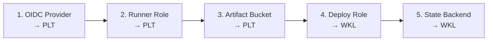

# CloudFormation StackSets

Foundation resources deployed via StackSets from management account.

## OU-Targeted Deployment

```
cloudformation/stacksets/
├── plt/                              # Deploy to PLT OU
│   ├── 00-oidc-provider-github.yaml  # GitHub OIDC provider
│   ├── 10-iam-runner-role.yaml       # Runner role (assumes WKL deploy roles)
│   └── 25-cicd-artifacts.yaml        # Artifact & cache bucket
│
└── wkl/                              # Deploy to WKL OU
    ├── 15-iam-deploy-role.yaml       # Deploy role (trusts PLT runner)
    └── 20-terraform-state-backend.yaml # State bucket + DynamoDB lock
```

## Deployment Order



## StackSet Configuration

### PLT OU StackSets

```bash
# 1. Deploy OIDC Provider to PLT OU
aws cloudformation create-stack-set \
  --stack-set-name plt-oidc-provider \
  --template-body file://stacksets/plt/00-oidc-provider-github.yaml \
  --parameters ParameterKey=GitHubOrganization,ParameterValue=YOUR_ORG \
  --permission-model SERVICE_MANAGED \
  --auto-deployment Enabled=true,RetainStacksOnAccountRemoval=false

aws cloudformation create-stack-instances \
  --stack-set-name plt-oidc-provider \
  --deployment-targets OrganizationalUnitIds=ou-xxxx-plt \
  --regions ca-central-1

# 2. Deploy Runner Role to PLT OU
aws cloudformation create-stack-set \
  --stack-set-name plt-runner-role \
  --template-body file://stacksets/plt/10-iam-runner-role.yaml \
  --parameters ParameterKey=GitHubOrganization,ParameterValue=YOUR_ORG \
  --capabilities CAPABILITY_NAMED_IAM \
  --permission-model SERVICE_MANAGED \
  --auto-deployment Enabled=true,RetainStacksOnAccountRemoval=false

aws cloudformation create-stack-instances \
  --stack-set-name plt-runner-role \
  --deployment-targets OrganizationalUnitIds=ou-xxxx-plt \
  --regions ca-central-1

# 3. Deploy Artifact Bucket to PLT OU (cache storage)
aws cloudformation create-stack-set \
  --stack-set-name plt-cicd-artifacts \
  --template-body file://stacksets/plt/25-cicd-artifacts.yaml \
  --parameters ParameterKey=OrganizationPrefix,ParameterValue=YOUR_ORG \
  --permission-model SERVICE_MANAGED \
  --auto-deployment Enabled=true,RetainStacksOnAccountRemoval=false

aws cloudformation create-stack-instances \
  --stack-set-name plt-cicd-artifacts \
  --deployment-targets OrganizationalUnitIds=ou-xxxx-plt \
  --regions ca-central-1
```

### WKL OU StackSets

```bash
# 4. Deploy Deploy Role to WKL OU (auto-deploys to WKL-NPD and WKL-PRD)
aws cloudformation create-stack-set \
  --stack-set-name wkl-deploy-role \
  --template-body file://stacksets/wkl/15-iam-deploy-role.yaml \
  --parameters ParameterKey=RunnerAccountId,ParameterValue=PLT_ACCOUNT_ID \
  --capabilities CAPABILITY_NAMED_IAM \
  --permission-model SERVICE_MANAGED \
  --auto-deployment Enabled=true,RetainStacksOnAccountRemoval=false

aws cloudformation create-stack-instances \
  --stack-set-name wkl-deploy-role \
  --deployment-targets OrganizationalUnitIds=ou-xxxx-wkl \
  --regions ca-central-1

# 5. Deploy State Backend to WKL OU
aws cloudformation create-stack-set \
  --stack-set-name wkl-terraform-state \
  --template-body file://stacksets/wkl/20-terraform-state-backend.yaml \
  --parameters \
    ParameterKey=OrganizationPrefix,ParameterValue=YOUR_ORG \
    ParameterKey=RunnerAccountId,ParameterValue=PLT_ACCOUNT_ID \
  --capabilities CAPABILITY_NAMED_IAM \
  --permission-model SERVICE_MANAGED \
  --auto-deployment Enabled=true,RetainStacksOnAccountRemoval=false

aws cloudformation create-stack-instances \
  --stack-set-name wkl-terraform-state \
  --deployment-targets OrganizationalUnitIds=ou-xxxx-wkl \
  --regions ca-central-1 ca-west-1
```

## Automatic Onboarding

With `--auto-deployment Enabled=true`, when new accounts are added to WKL OU:

1. StackSet automatically deploys `cicd-deploy-role` to the new account
2. StackSet automatically deploys state backend to the new account
3. Trust policy already references PLT runner role ARN
4. New account immediately ready for CI/CD deployments

## Role Trust Relationship

```
PLT Account                        WKL Accounts
───────────                        ────────────
cicd-runner-role  ──────────────>  cicd-deploy-role
  │                                  │
  ├─ OIDC trust (GitHub)             ├─ Trusts PLT runner role ARN
  └─ Can assume WKL deploy roles     └─ Full infra permissions
```

## OU IDs

Get your OU IDs:

```bash
aws organizations list-organizational-units-for-parent \
  --parent-id r-xxxx  # root ID
```

Replace `ou-xxxx-plt` and `ou-xxxx-wkl` with your actual OU IDs.

## File Naming Convention

| Range | Layer              |
| ----- | ------------------ |
| 00-09 | Identity providers |
| 10-19 | IAM roles/policies |
| 15-19 | Deploy roles       |
| 20-29 | State & artifacts  |
| 30-39 | Network foundation |
| 40-49 | Security baseline  |
