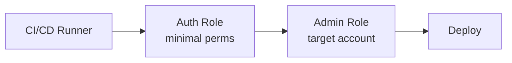

# Authentication

Role chaining pattern for CI/CD pipelines on AWS.

## AWS Account Model

| Account  | Environments  | Roles                           |
| -------- | ------------- | ------------------------------- |
| Non-Prod | dev, qat      | cicd-oidc-role, cicd-admin-role |
| Prod     | stg, prod, dr | cicd-oidc-role, cicd-admin-role |

Each account has its own set of roles. Pipeline assumes role in target account.

## Pattern



## Why Role Chaining?

| Benefit       | Description                                                |
| ------------- | ---------------------------------------------------------- |
| Separation    | Auth role handles identity, admin role handles permissions |
| Auditability  | Single admin role per account to review                    |
| Flexibility   | Multiple auth methods share same admin role                |
| Cross-account | Same pattern works for both accounts                       |

## Roles (per account)

| Role               | Purpose                   | Permissions             |
| ------------------ | ------------------------- | ----------------------- |
| `cicd-oidc-role`   | OIDC auth (GitHub/GitLab) | `sts:AssumeRole` only   |
| `cicd-runner-role` | EC2 instance profile      | `sts:AssumeRole` only   |
| `cicd-admin-role`  | Infrastructure operations | Full deploy permissions |

## Auth Methods

| Method             | Use Case                       | Secrets Stored |
| ------------------ | ------------------------------ | -------------- |
| OIDC + Role Chain  | GitHub Actions, GitLab Premium | None           |
| IMDv2 + Role Chain | Self-hosted EC2 runners        | None           |

## Platform Config

### GitHub Actions

```yaml
# Role ARNs are not sensitive - hardcode in workflow or use variables
env:
  OIDC_ROLE_ARN_NONPROD: arn:aws:iam::111111111111:role/cicd-oidc-role
  OIDC_ROLE_ARN_PROD: arn:aws:iam::222222222222:role/cicd-oidc-role
  ADMIN_ROLE_ARN_NONPROD: arn:aws:iam::111111111111:role/cicd-admin-role
  ADMIN_ROLE_ARN_PROD: arn:aws:iam::222222222222:role/cicd-admin-role

permissions:
  id-token: write
  contents: read
```

### GitLab CI

```yaml
# Variables (per environment) - not secrets, role ARNs are public
variables:
  OIDC_ROLE_ARN: arn:aws:iam::${AWS_ACCOUNT_ID}:role/cicd-oidc-role
  ADMIN_ROLE_ARN: arn:aws:iam::${AWS_ACCOUNT_ID}:role/cicd-admin-role
```

## Cross-Account Flow

```
Deploy to Non-Prod (dev, qat):
  Runner → Non-Prod OIDC Role → Non-Prod Admin Role → Deploy

Deploy to Prod (stg, prod, dr):
  Runner → Prod OIDC Role → Prod Admin Role → Deploy
```

## Security

- Use OIDC (zero stored secrets)
- Separate roles per account
- Restrict OIDC trust to specific repos
- Short session durations (1-2 hours)
