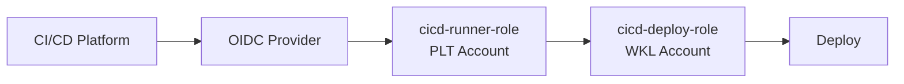

# Authentication

Cross-account role chaining pattern for CI/CD pipelines on AWS.

## OU Model

| OU      | Account(s)    | Roles            |
| ------- | ------------- | ---------------- |
| PLT     | PLT-Runner    | cicd-runner-role |
| WKL-NPD | SBX, DEV, QAT | cicd-deploy-role |
| WKL-PRD | STG, PRD, DR  | cicd-deploy-role |

Runner in PLT assumes deploy roles in WKL accounts.

## Pattern



## Why Cross-Account Role Chaining?

| Benefit             | Description                                         |
| ------------------- | --------------------------------------------------- |
| **Isolation**       | Runner has no infra permissions, only assume role   |
| **Blast Radius**    | Compromise of one WKL account doesn't affect others |
| **Auto-Onboarding** | New WKL accounts automatically get deploy roles     |
| **Auditability**    | Single deploy role per WKL account to review        |
| **Zero Secrets**    | OIDC tokens, no stored credentials                  |

## Roles

| Role               | OU  | Purpose                   | Permissions             |
| ------------------ | --- | ------------------------- | ----------------------- |
| `cicd-runner-role` | PLT | OIDC auth + cross-account | `sts:AssumeRole` to WKL |
| `cicd-deploy-role` | WKL | Infrastructure operations | Full deploy permissions |

## Auth Methods

| Method             | Use Case                       | Secrets Stored |
| ------------------ | ------------------------------ | -------------- |
| OIDC + Role Chain  | GitHub Actions, GitLab Premium | None           |
| IMDv2 + Role Chain | Self-hosted EC2 runners in PLT | None           |

## Platform Config

### GitHub Actions

```yaml
# Role ARNs in PLT account
env:
  RUNNER_ROLE_ARN: arn:aws:iam::111111111111:role/cicd-runner-role

  # WKL account deploy roles
  DEPLOY_ROLE_SBX: arn:aws:iam::222222222222:role/cicd-deploy-role
  DEPLOY_ROLE_DEV: arn:aws:iam::333333333333:role/cicd-deploy-role
  DEPLOY_ROLE_QAT: arn:aws:iam::444444444444:role/cicd-deploy-role
  DEPLOY_ROLE_STG: arn:aws:iam::555555555555:role/cicd-deploy-role
  DEPLOY_ROLE_PRD: arn:aws:iam::666666666666:role/cicd-deploy-role
  DEPLOY_ROLE_DR: arn:aws:iam::777777777777:role/cicd-deploy-role

permissions:
  id-token: write
  contents: read
```

### GitLab CI

```yaml
# Variables (per environment)
variables:
  RUNNER_ROLE_ARN: arn:aws:iam::${PLT_ACCOUNT_ID}:role/cicd-runner-role
  DEPLOY_ROLE_ARN: arn:aws:iam::${WKL_ACCOUNT_ID}:role/cicd-deploy-role
```

## Cross-Account Flow

```
Deploy to WKL-NPD (sbx, dev, qat):
  GitHub → OIDC → PLT Runner Role → WKL-NPD Deploy Role → Deploy

Deploy to WKL-PRD (stg, prod, dr):
  GitHub → OIDC → PLT Runner Role → WKL-PRD Deploy Role → Deploy
```

## Trust Policies

**Runner Role (PLT OU):**

```yaml
AssumeRolePolicyDocument:
  Statement:
    - Effect: Allow
      Principal:
        Federated: !Sub arn:aws:iam::${AWS::AccountId}:oidc-provider/token.actions.githubusercontent.com
      Action: sts:AssumeRoleWithWebIdentity
      Condition:
        StringEquals:
          token.actions.githubusercontent.com:aud: sts.amazonaws.com
        StringLike:
          token.actions.githubusercontent.com:sub: repo:org/*:*
```

**Deploy Role (WKL OU):**

```yaml
AssumeRolePolicyDocument:
  Statement:
    - Effect: Allow
      Principal:
        AWS: arn:aws:iam::PLT_ACCOUNT_ID:role/cicd-runner-role
      Action: sts:AssumeRole
```

## Security

- Use OIDC (zero stored secrets)
- Runner role in PLT, deploy roles in WKL
- Restrict OIDC trust to specific repos
- Short session durations (1-2 hours)
- Deploy roles trust only the runner role ARN
