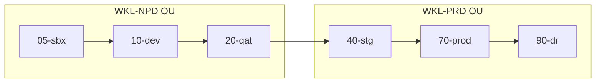

# Pipeline Rules

When pipelines run, deployment patterns, and caching strategies.

## OU Model

| OU      | Environments  | Deploy From                  |
| ------- | ------------- | ---------------------------- |
| PLT     | runner        | N/A (infrastructure only)    |
| WKL-NPD | sbx, dev, qat | PR or main                   |
| WKL-PRD | stg, prod, dr | main only (prod requires CR) |

## Triggers

| Event               | Runs?  | Why               |
| ------------------- | ------ | ----------------- |
| Feature branch push | **NO** | No value until PR |
| PR/MR opened        | YES    | Ready for review  |
| Main branch         | YES    | Merged code       |
| Manual              | YES    | Explicit action   |

**Why skip feature branches?** 10 WIP commits = 10 wasted runs. Wait for PR.

## Deployment Flow



## Rules by Environment

| Stage    | OU      | PR/MR   | Main   | Requires CR |
| -------- | ------- | ------- | ------ | ----------- |
| validate | -       | auto    | auto   | no          |
| plan     | -       | auto    | auto   | no          |
| 05-sbx   | WKL-NPD | manual  | manual | no          |
| 10-dev   | WKL-NPD | manual  | manual | no          |
| 20-qat   | WKL-NPD | blocked | manual | no          |
| 40-stg   | WKL-PRD | blocked | manual | no          |
| 70-prod  | WKL-PRD | blocked | manual | **yes**     |
| 90-dr    | WKL-PRD | blocked | manual | no          |

## Path Filtering

Only run when relevant files change:

| Tool           | Paths                        |
| -------------- | ---------------------------- |
| Terraform      | `**.tf`, `**.tfvars`         |
| Ansible        | `ansible/**`, `playbooks/**` |
| CloudFormation | `cloudformation/**`          |

## Change Request (CR)

Production (70-prod) requires CR because:

- Audit trail
- Compliance (SOC2, HIPAA, PCI)
- Rollback plan documented
- Stakeholder awareness

---

## Caching Strategy

### Why Cache?

| Task                         | Without Cache | With Cache | Savings |
| ---------------------------- | ------------- | ---------- | ------- |
| Download Terraform providers | 30-60s        | 2-5s       | ~90%    |
| Install Ansible collections  | 20-40s        | 1-3s       | ~92%    |
| pip/npm install              | 45-90s        | 3-8s       | ~91%    |

**A 5-minute pipeline becomes 1-2 minutes with proper caching.**

### Cache Locations

| Cache Type  | Location                      | TTL    |
| ----------- | ----------------------------- | ------ |
| Terraform   | `~/.terraform.d/plugin-cache` | 7 days |
| Ansible     | `~/.ansible/collections`      | 3 days |
| pip         | `~/.cache/pip`                | 3 days |
| npm         | `~/.npm` or `node_modules/`   | 3 days |
| S3 artifact | `s3://${ARTIFACT_BUCKET}/`    | varies |

### Cache Keys (Content-Based)

```bash
# Use lockfile hash for cache keys
terraform-${{ hashFiles('.terraform.lock.hcl') }}
ansible-${{ hashFiles('requirements.yml') }}
pip-${{ hashFiles('requirements.txt') }}
npm-${{ hashFiles('package-lock.json') }}
```

### Expiration Policy (CRITICAL)

**Caches MUST expire for security updates:**

| Artifact          | TTL    | Reason                       |
| ----------------- | ------ | ---------------------------- |
| Terraform plugins | 7 days | Versioned, less frequent CVE |
| Ansible roles     | 3 days | May have security fixes      |
| pip/npm packages  | 3 days | Frequent security patches    |
| Container images  | 1 day  | Base images get CVE fixes    |
| Plan artifacts    | 1 day  | Job-specific, no reuse       |

### Pipeline Stages with Caching

```yaml
stages:
  - restore-cache # Download from S3/cache
  - validate # Format, lint
  - plan # Terraform plan
  - save-cache # Upload to S3/cache
  - deploy # Apply (manual)
```

### Cache Invalidation

Force refresh when needed:

```yaml
# Weekly scheduled refresh
on:
  schedule:
    - cron: '0 0 * * 0'  # Every Sunday

# Manual refresh input
on:
  workflow_dispatch:
    inputs:
      refresh_cache:
        type: boolean
        default: false
```

> **Reference:** See [docs/caching.md](caching.md) for complete implementation.

---

## Platform Implementation

| Concept             | GitHub                             | GitLab                  | Jenkins         |
| ------------------- | ---------------------------------- | ----------------------- | --------------- |
| Skip feature branch | Only `pull_request` + `push: main` | `workflow: rules:`      | Branch filter   |
| Manual deploy       | Environment protection             | `when: manual`          | `input` step    |
| CR check            | `inputs.change_request != ''`      | `$CHANGE_REQUEST != ""` | Parameter check |
| Path filter         | `paths:`                           | `changes:`              | `changeset`     |
| Cache (native)      | `actions/cache@v4`                 | `cache:` keyword        | Workspace       |
| Cache (S3)          | AWS CLI                            | AWS CLI                 | AWS CLI         |

### GitHub Actions Cache

```yaml
- uses: actions/cache@v4
  with:
    path: ~/.terraform.d/plugin-cache
    key: terraform-${{ runner.os }}-${{ hashFiles('**/.terraform.lock.hcl') }}
    restore-keys: terraform-${{ runner.os }}-
```

### GitLab CI Cache

```yaml
cache:
  key:
    files:
      - .terraform.lock.hcl
  paths:
    - .terraform/providers/
  policy: pull-push
```

### S3 Backend Cache (All Platforms)

```bash
# Download
CACHE_KEY="terraform-$(sha256sum .terraform.lock.hcl | cut -d' ' -f1)"
aws s3 cp "s3://${ARTIFACT_BUCKET}/${CACHE_KEY}.tar.gz" /tmp/cache.tar.gz || true

# Upload (after init)
tar -czf /tmp/cache.tar.gz -C ~/.terraform.d/ plugin-cache/
aws s3 cp /tmp/cache.tar.gz "s3://${ARTIFACT_BUCKET}/${CACHE_KEY}.tar.gz"
```

**GitLab note:** Rules cannot be inherited from templates. Define at job level.
