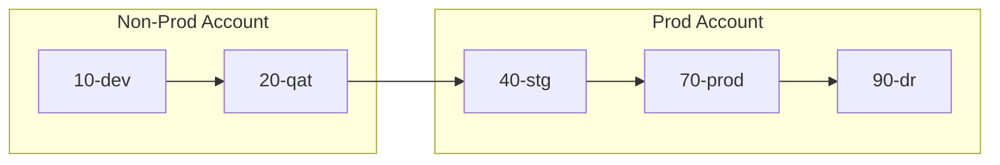

# Pipeline Rules

When pipelines run and deployment patterns.

## AWS Account Model

| Account  | Environments  | Deploy From                  |
| -------- | ------------- | ---------------------------- |
| Non-Prod | dev, qat      | PR or main                   |
| Prod     | stg, prod, dr | main only (prod requires CR) |

## Triggers

| Event               | Runs?  | Why               |
| ------------------- | ------ | ----------------- |
| Feature branch push | **NO** | No value until PR |
| PR/MR opened        | YES    | Ready for review  |
| Main branch         | YES    | Merged code       |
| Manual              | YES    | Explicit action   |

**Why skip feature branches?** 10 WIP commits = 10 wasted runs. Wait for PR.

## Deployment Flow

## Rules by Environment

| Stage    | Account  | PR/MR   | Main   | Requires CR |
| -------- | -------- | ------- | ------ | ----------- |
| validate | -        | auto    | auto   | no          |
| plan     | -        | auto    | auto   | no          |
| 10-dev   | Non-Prod | manual  | manual | no          |
| 20-qat   | Non-Prod | blocked | manual | no          |
| 40-stg   | Prod     | blocked | manual | no          |
| 70-prod  | Prod     | blocked | manual | **yes**     |
| 90-dr    | Prod     | blocked | manual | no          |

## Path Filtering

Only run when relevant files change:

| Tool           | Paths                        |
| -------------- | ---------------------------- |
| Terraform      | `**.tf`, `**.tfvars`         |
| Ansible        | `ansible/**`, `playbooks/**` |
| CloudFormation | `cloudformation/**`          |

## Change Request (CR)

Production (70-prod) requires CR because:

- Audit trail
- Compliance (SOC2, HIPAA, PCI)
- Rollback plan documented
- Stakeholder awareness

## Platform Implementation

| Concept             | GitHub                             | GitLab                  | Jenkins         |
| ------------------- | ---------------------------------- | ----------------------- | --------------- |
| Skip feature branch | Only `pull_request` + `push: main` | `workflow: rules:`      | Branch filter   |
| Manual              | Environment protection             | `when: manual`          | `input` step    |
| CR check            | `inputs.change_request != ''`      | `$CHANGE_REQUEST != ""` | Parameter check |
| Path filter         | `paths:`                           | `changes:`              | `changeset`     |

**GitLab note:** Rules cannot be inherited from templates. Define at job level.
